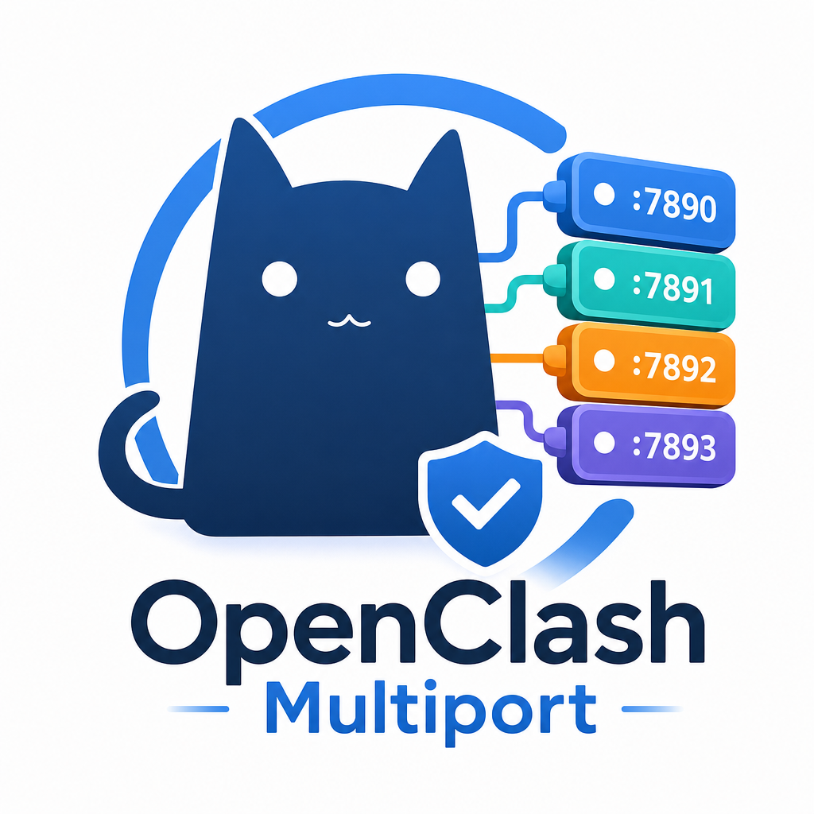

<div align="center">


# OpenClash-Multiport
基于 OpenClash 的多端口代理定制模块，
支持多端口代理的新增、编辑、删除和启停，可为每个端口选择出口节点、设置独立账号密码。
</div>

<p align="center" style="font-weight: bold">
  本项目认可并支持 <a href="https://linux.do/">LINUX DO</a> 社区。
</p>

<p align="center">
  <strong>README</strong> &nbsp;|&nbsp;
  <a href="效果演示.md">效果演示</a> &nbsp;|&nbsp;
  <a href="安装说明.md">安装说明</a> &nbsp;|&nbsp;
  <a href="实现说明.md">实现说明</a>
</p>

## 目录

```text
openclash-multiport/
├── AGENTS.md                  # AI 开发入口
├── status.htm                 # LuCI 状态页
├── oc-proxy-multiport.css           # 页面样式
├── oc-proxy-multiport.js            # 前端交互与接口调用
├── backend/
│   ├── openclash_proxy_multiport.lua       # LuCI 接口
│   └── openclash_proxy_multiport.rb        # 配置应用、持久化及代理检测与节点目录
├── tests/                     # 隔离回归测试，仅开发时使用
├── install.sh                 # 路由器安装脚本
├── 效果演示.md
├── 安装说明.md
├── 实现说明.md
├── LICENSE                    # MIT 开源协议
├── SHA256SUMS                 # 文件校验值
└── .editorconfig
```

本目录包含此次定制功能需要覆盖的完整文件，需要安装在已有的 OpenClash 上。页面引用的原版公共 CSS、JS、控制面板和 Mihomo 内核由 OpenClash 提供。

AI 协助开发前先阅读 [AGENTS.md](AGENTS.md)，其中列出代码职责、开发约定及验证方式，并链接到详细文档。

## 安装入口

将整个 `openclash-multiport` 文件夹上传到路由器 `/tmp/openclash-multiport`，以 root 执行：

```sh
sh /tmp/openclash-multiport/install.sh
```

安装后重新登录 LuCI，按 Ctrl+F5 刷新。详细路径和手动部署步骤见[安装说明](安装说明.md)，接口与配置流程见[实现说明](实现说明.md)。

菜单提供“安装 / 更新”“恢复备份”“退出”三项。脚本输出 OpenClash 和内核版本，并将原文件备份到 `~/openclash-multiport-back/时间目录/`。首次仅备份原页面，更新时备份整套已部署文件。恢复列表按时间从旧到新显示；也可执行 `sh /tmp/openclash-multiport/install.sh restore` 选择恢复，端口数据保留。

## 当前版本

当前统一版本为 **v1.0.1**，上一发布版本为 **v1.0.0**。各组件使用相同版本，仅在确认发布升级时统一更新。

| 文件 | 版本标识 |
| --- | --- |
| backend/openclash_proxy_multiport.lua | v1.0.1 |
| backend/openclash_proxy_multiport.rb | v1.0.1 |
| status.htm 引用的 CSS、JS | v1.0.1 |

此版本已包含空数组 JSON 保留、临时请求文件独占创建、内核错误摘要及敏感信息隐藏、校验进程 SAFE_PATHS 设置。

文件名已统一为前端 `oc-proxy-multiport.*`、后端 `openclash_proxy_multiport.rb` 和 `openclash_proxy_multiport.lua`。安装脚本会处理旧控制器和覆写调用路径；已有端口数据继续沿用原存储路径。详见安装说明。

不额外要求安装 ruby-json、ruby-open3、ruby-tempfile、ruby-socket 或 ruby-fileutils；复用 OpenClash 已有的 Ruby/YAML、curl、uci、LuCI/nixio 和 Linux 网络状态文件。安装脚本要求 Ruby 2.7 或更高版本。

本次更新：主表只检测 Mihomo 节点延迟，去掉后台入口检测及首次请求耗时。节点队列完成后立即恢复刷新按钮，不新增表格列。

## 使用范围

- “工作节点”列中，默认混合代理显示“当前策略出口”；它仍禁止编辑、删除和关闭。
- 自定义入口只支持路由器本机 IPv4 地址及 1024–65535 端口，最多 100 项。
- 新增/编辑弹窗的“出口节点”为只读输入框，点击右侧“选择节点”，在第二层居中弹窗中选择当前配置的代理节点。支持按名称、类型、server 或 IP 搜索；选中立即回填，最后点击“保存并应用”生效。
- 节点卡片显示名称、协议类型、server、服务器 IP 和延迟。IP 为服务器 DNS 解析结果，不是出口 IP；无法获取的内容显示 `-`。未加载的节点标记“未加载”并禁止选择。
- 节点选择弹窗首次使用内核已有的测速记录，可批量刷新筛选结果或点击单个延迟检测。主表与弹窗均使用 Mihomo 节点 `/delay` 接口、Google 204 地址及 5000 毫秒超时；测试时间和连接状态不同仍可能产生差异。
- “延迟”列居中显示紧凑标签，高 22px、字号 12px，采用正常字重和与快捷操作一致的灰色背景，仅用文字颜色区分延迟：≤200 ms 为绿色，201–500 ms 为黄色，>500 ms 为红色。悬停、点击及键盘聚焦时显示蓝色细边框。未检测、停用或失败时显示 `-`；检测中只在对应单元格显示转圈加载。
- 主表节点测速先解析自定义入口指定的节点或策略组当前选择；默认入口全局模式使用 GLOBAL 当前选择，直连模式使用 DIRECT。默认入口在规则模式下没有唯一工作节点，延迟显示 `-`。没有固定选择的策略组按组测速，结果不能代表每次分流的所有节点。
- 主表只请求 Mihomo 节点测速接口，不检查代理端口和认证；节点延迟正常不表示入口认证已通过实际访问验证。
- 进入页面时自动检测所有已启用且已应用的入口一次，包含默认混合代理；默认地址尚未就绪时补测。开始提交配置会结束本次首次检测，包括仍在等待默认代理状态的任务，避免它在保存后与修改行一起转圈。应用配置成功后，只检测新增、实际修改或重新启用的可用入口；默认代理和未修改入口保留上次检测值，没有历史结果时显示 `-`，可点击单独检测。停用、删除及保存相同内容不触发额外测速。状态更新不会重复触发，失败后不自动重试。
- 点击任一延迟标签（包括可用入口的 `-`）只刷新该行节点延迟；自动、单行与批量刷新共用最多 5 个并发任务。成功或失败后结束该行加载，全部节点完成后立即恢复“刷新延迟”按钮，其他配置仍可操作。
- 正常延迟不显示悬浮提示；显示 `-` 时悬停查看未检测、停用或测速失败的原因，不展示首次请求耗时。
- 测速期间切换工作节点会丢弃旧结果；页面切换代理模式时清除默认入口旧值。结果是最近一次检测的快照，在其他面板切换节点后应重新刷新。
- 检测期间可新增、编辑、启停、删除和复制。提交配置取消旧检测队列并忽略旧请求返回，保留已完成的检测值；未修改行正在检测时恢复其上一次结果，没有历史值时显示 `-`。应用成功后只为变更行安排检测，新旧请求共用并发上限。应用失败不会清空已完成结果。结果只保留在当前页面。
- 配置保存在路由器；旧浏览器草稿不会自动导入或启用。

本次节点选择功能已完成本地交互、后端模拟及浏览器预览检查，尚未在用户路由器实测。重启后恢复、订阅更新后的恢复以及各协议客户端的使用仍应按部署环境验证。

## 开源协议

本项目采用 [MIT License](LICENSE)，包含基于 [OpenClash](https://github.com/vernesong/OpenClash) 状态页的修改，保留上游版权和许可声明。OpenClash、Mihomo 及其他依赖分别遵循各自的许可证。
