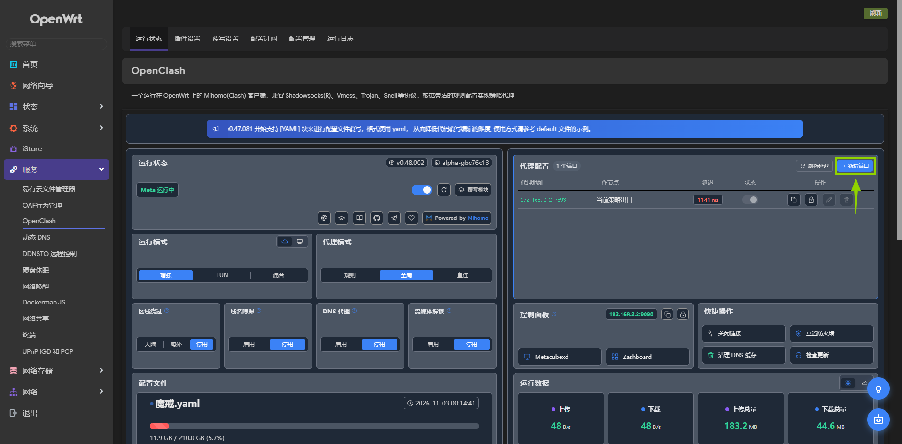
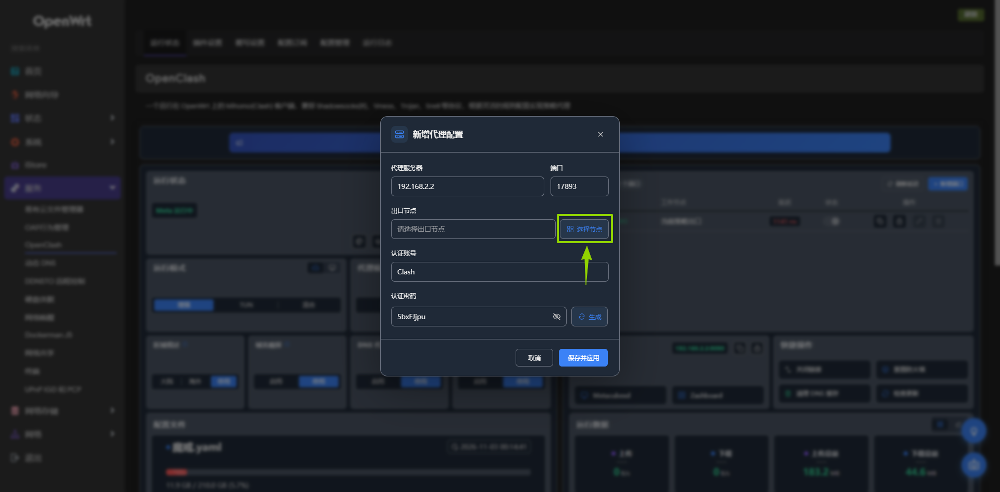
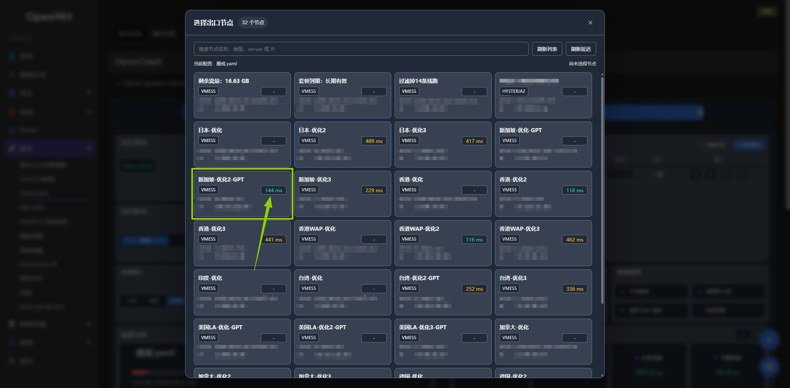
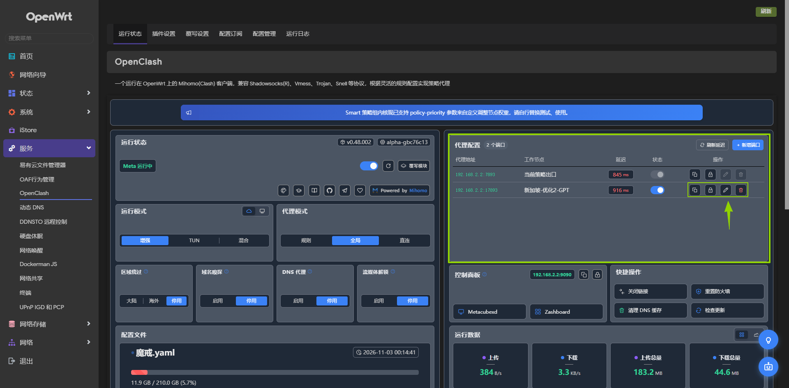
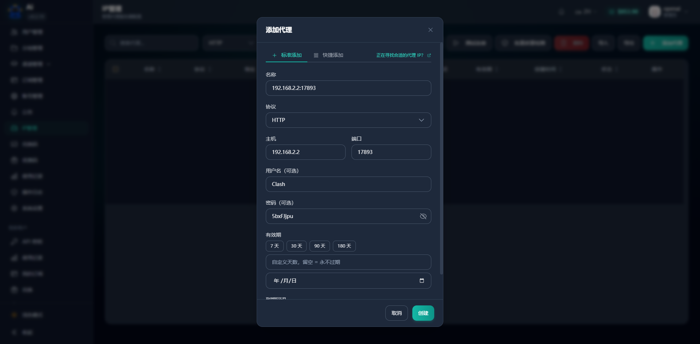
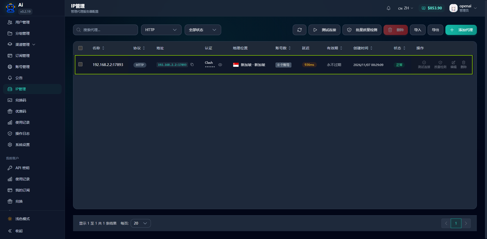

# 效果演示

  <a href="README.md">README</a> &nbsp;|&nbsp;
  <strong>效果演示</strong> &nbsp;|&nbsp;
  <a href="安装说明.md">安装说明</a> &nbsp;|&nbsp;
  <a href="实现说明.md">实现说明</a>

## 前言
 实际上这个多端口代理功能是为了解决 `Sub2Api` 的 `IP管理` 问题，因为我本身有一台软路由，但是软路由上 `openclash` 的混合代理只是当前我选中的节点作为出口，我不想使用策略让他自动路由，我想 `chatgpt` 每一个账号指定一个固定的节点出口，这样能减少一定的封号风险。

## 新增代理
1. 点击右侧代理配置的 `新增端口` 弹出新增代理窗口。

2. 填写路由器本机 `IPv4`、`未占用端口`, 并点击 `选择节点` 弹出节点选择窗口。

3. 选择 `延迟` 比较低的出口节点, 点击 `节点卡片` 即可。

4. 点击 `保存并应用` 后主页面即可看到新增的代理端口，操作列 `从左到右` 分别是 `复制IP和端口信息`、`复制认证信息`、`编辑代理`、`删除代理`。

5. 在 `Sub2Api` 的 `IP管理` 中添加代理，填写路由器本机 `IPv4`、`端口`、`认证账号`、`认证密码` 即可。

6. 在 `Sub2Api` 的 `IP管理` 中点击 `测试代理` 即可验证代理是否可用。

## 结语
以上就是 `OpenClash-Multiport` 的使用方法，其主要作用就是通过它能够开放出多个 `端口->出口节点` 的代理，在 `Sub2Api` 中每个账号就可以通过这种方式来设置不同的代理出口了。